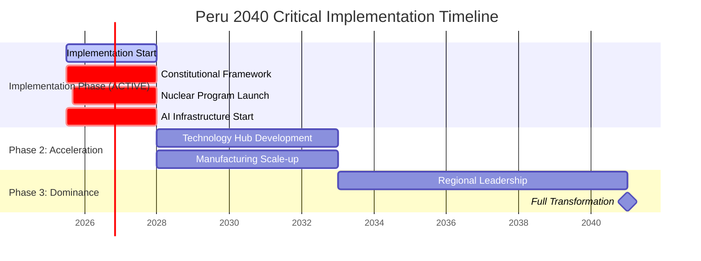
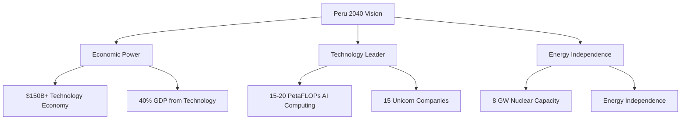

# Peru 2040: Strategic Technological Sovereignty

> **An open-source national strategy for transforming Peru into Latin America's leading technology powerhouse by 2040**

## 🎯 What is Peru 2040?

Peru 2040 is a comprehensive strategic framework to transform Peru from a commodity-dependent economy into a high-technology, high-income nation by 2040. This open-source approach enables collaborative development of national strategy through evidence-based planning and transparent governance.

> **⚡ CRITICAL TIMELINE: 15.5 Years Remaining**  
> **Time is non-negotiable.** As of June 30, 2025, the strategy phase is complete and implementation must begin immediately. Every month of delay now directly increases costs and reduces achievable outcomes. The window for planning is closed—this is the moment for action.

**Key Transformation Areas:**
- 🤖 Artificial Intelligence & Computing Infrastructure  
- ⚡ Nuclear Energy & Renewable Systems
- 🏭 Advanced Manufacturing & Materials
- 🌍 Modern Soft Power & Cultural Exports
- 💰 $93B Investment Framework over 15 years

## 📋 Quick Navigation

| Document | Description |
|----------|-------------|
| [**⚡ URGENCY TRACKER**](URGENCY_TRACKER.md) | **Time constraint analysis & daily impact** |
| [**📖 Full White Paper**](docs/peru-2040-white-paper.md) | Complete strategic plan (2,376 pages) |
| [**🚀 Getting Started**](BEGINNER_GUIDE.md) | New contributor guide |
| [**🤝 Contributing**](CONTRIBUTING.md) | How to contribute |
| [**❓ FAQ**](FAQ.md) | Frequently asked questions |
| [**🗺️ Roadmap**](ROADMAP.md) | Implementation timeline |

## ⏰ Critical Timeline - Implementation Phase Begins

## 📈 Current Status

- **Phase**: Implementation Phase (ACTIVE) ⚡ **URGENT**
- **Contributors**: [See Contributors](CONTRIBUTORS.md)
- **Last Updated**: December 2025
- **⏰ CRITICAL DEADLINE**: Phase 1 Implementation (2025-2026) - **ACCELERATED**
- **🚨 TIME REMAINING**: 15 years to achieve full transformation
- **📊 Implementation Window**: Immediate—no further delay possible

### 🔄 Strategic Update (December 2025)

> **Version 1.2.0 Released** - Comprehensive validation of July 2025 strategy against December 2025 reality. [See CHANGELOG](CHANGELOG.md#120---2025-12-17) for full details.

**Key Strategic Revisions:**
- ⚡ **AI Infrastructure**: Timeline compressed to 2-3 years (from 3-5 years) based on GB200 performance (30x improvement) and Project Stargate $500B investment context
- ✅ **Energy Costs**: Renewable assumptions **exceeded** - $65/MWh achieved (vs $80-100/MWh projected), 89% battery cost reduction validates strategy
- 🔄 **Nuclear Timeline**: Deferred 5-10 years due to renewable cost parity achievement, prioritize Phase 1 solar + storage
- 🌍 **Middle Eastern SWF**: New partnership opportunity with MGX (UAE), PIF (Saudi), Mubadala based on Project Stargate precedent
- 🏭 **Manufacturing Focus**: Strategic shift from chip fabrication to AI/compute assembly (TSMC 66% market dominance)
- ⏰ **Phase 1 Acceleration**: Compressed from 2025-2027 to 2025-2026 due to technology acceleration curves

**Overall Validation**: Strategy **CONFIRMED** with timeline acceleration required (Confidence: 0.87)

## 🎯 Target Outcomes by 2040

## 🚀 How to Get Involved

> **🔥 URGENT CONTRIBUTIONS NEEDED**  
> We need expert input **NOW**. Implementation must begin immediately or we risk missing critical technology windows. Your expertise today determines Peru's position in 2040.

### For Policy Experts & Researchers
- **PRIORITY**: Support implementation monitoring and evaluation
- **URGENT**: Provide real-time feedback on policy execution
- **CRITICAL**: Document lessons learned for future phases

### For Technologists
- **PRIORITY**: Lead deployment of AI and computing infrastructure
- **URGENT**: Oversee energy transition execution
- **CRITICAL**: Implement governance models for emerging technologies

### For Economists & Analysts  
- **PRIORITY**: Track financial performance and investment flows
- **URGENT**: Update risk assessment frameworks as implementation proceeds
- **CRITICAL**: Benchmark progress against international comparators

### For All Contributors
- **🚨 HIGH IMPACT**: Join discussions in [Issues](../../issues)
- **⏰ TIME-SENSITIVE**: Improve documentation and accessibility
- **💡 EXPERTISE NEEDED**: Share insights from your expertise area

## 📚 Key Documents

### Core Strategy
- [📄 Executive Summary](docs/executive-summary.md) - 5-page overview
- [📊 Financial Framework](docs/financial/investment-model.md) - $93B investment plan
- [⚡ Energy Strategy](docs/sectors/energy-sovereignty.md) - Nuclear + renewables
- [🤖 AI Strategy](docs/sectors/ai-computing.md) - Computing infrastructure plan

### Implementation
- [📅 Phase 1: Foundation (2025-2027)](docs/implementation/phase-1-foundation.md)
- [🏛️ Governance Framework](docs/governance/institutional-framework.md)
- [💼 International Partnerships](docs/international-partnerships.md)

## 🌟 Why Open Source Strategy?

Traditional national planning happens behind closed doors. We believe:

- **Transparency** builds public trust and accountability
- **Collaboration** leverages global expertise and best practices  
- **Evidence-based** approach ensures realistic, achievable goals
- **Democratic participation** strengthens implementation legitimacy

## 🤝 Community

- **💬 Discussions**: Share ideas and ask questions
- **🐛 Issues**: Report problems or suggest improvements
- **🔧 Pull Requests**: Contribute directly to the strategy
- **📧 Contact**: Create an issue or tag [@MRCORD](https://github.com/MRCORD) for direct contact

## 📜 License

This project is licensed under the [MIT License](LICENSE) - see the file for details.

## 🏆 Recognition

*Peru 2040 represents one of the first open-source approaches to national strategic planning, demonstrating how democratic participation and transparency can enhance policy development.*

---

**Ready to help transform Peru's future?** [Start here](BEGINNER_GUIDE.md) | [Read the full strategy](docs/peru-2040-white-paper.md) | [Join the discussion](../../discussions) 